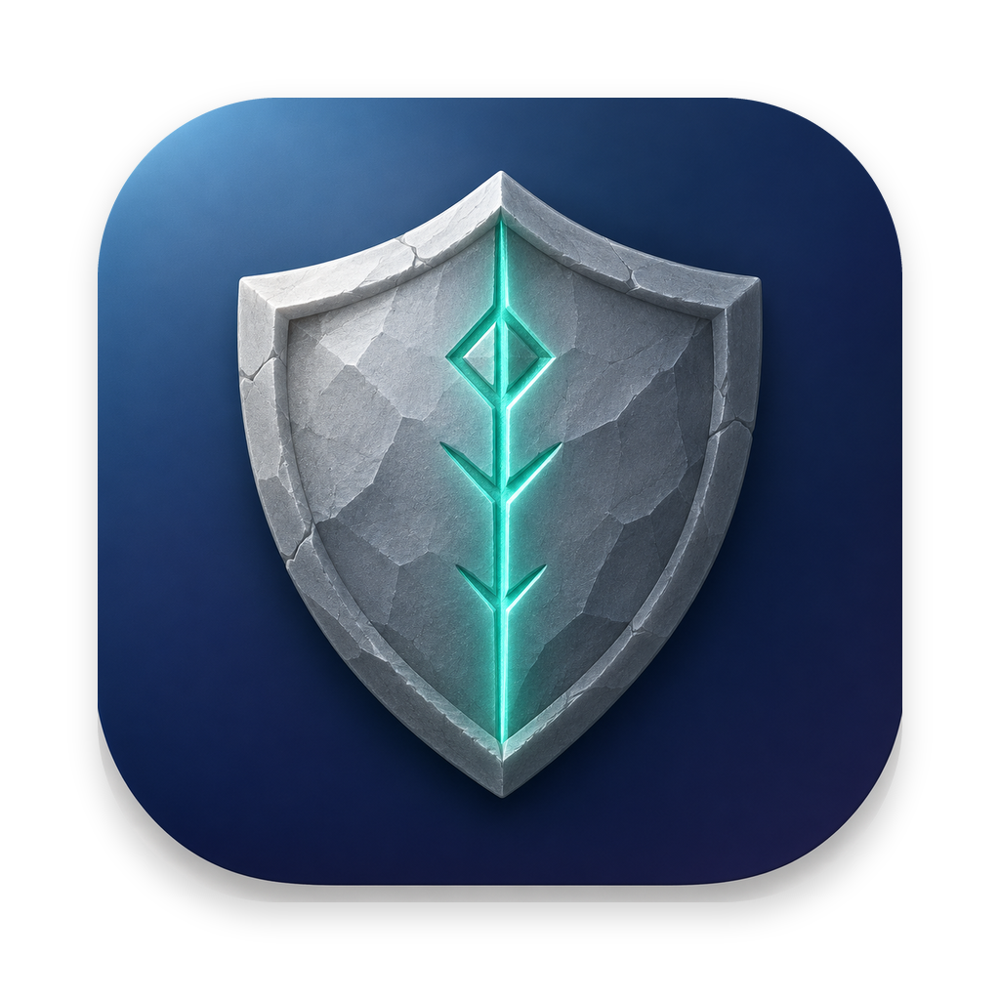

# Galio



A League of Legends companion for macOS (Apple Silicon, macOS 15+): champion suggestions by team composition, rune pages with one-click import, summoner spells, skill order, item builds re-ranked against the visible enemy team, ARAM: Mayhem / Arena augment tiers (on-device OCR), post-game review and history. Turkish UI with English translation.

Docs: [User guide (TR)](docs/USER_GUIDE.md) · [Spec](docs/SPEC.md) · [Status](docs/STATUS.md) · [Data](docs/DATA.md) · [Release notes](docs/RELEASE_NOTES.md)

## Install

1. Download `Galio.zip` from [Releases](https://github.com/kpostaagasi/galio/releases) and unzip it into `/Applications`.
2. The build is ad-hoc signed (not notarized). On first launch, **right-click `Galio.app` → Open** and confirm; afterwards it opens normally.

Try it without a running game:

```bash
open Galio.app --args --mock-game champselect   # also: champselect-locked, ingame, aram, mayhem, arena, postgame
```

## Build from source

Requires macOS 15+, Xcode and [XcodeGen](https://github.com/yonaskolb/XcodeGen). Swift 5 language mode, Apple frameworks only, no third-party dependencies. The `.xcodeproj` is generated from `project.yml` and not committed.

```bash
brew install xcodegen
xcodegen generate
xcodebuild test -project Galio.xcodeproj -scheme Galio -destination 'platform=macOS,arch=arm64'
xcodebuild -project Galio.xcodeproj -scheme Galio -configuration Release build
```

UI strings: Turkish literals are String Catalog keys; English goes in `tools/l10n/en.json`, then run `python3 tools/l10n.py` (CI fails if the catalog is stale).

CI (`.github/workflows/build.yml`) builds, runs the XCTest suite, launches every mock scenario and uploads screenshots plus the app as a build artifact on each push.

## Data pipeline (`tools/`)

The app downloads recommendation data via `data/manifest.json` in this repo (falling back to the bundled copy in `Galio/Resources/BundledData/`). It never scrapes third-party stat sites. Sources: Riot Data Dragon, CommunityDragon, hand-curated rules in `tools/curated/`, and optional anonymous Riot Match-v5 aggregates. Details: [docs/DATA.md](docs/DATA.md).

```bash
python3 tools/build_data.py --bundle                     # rebuild data for the latest patch + bundled copy
python3 -m unittest tools/test_pipeline.py               # pipeline tests
python3 tools/aggregate_matches.py --budget-minutes 45   # optional Match-v5 sampling
tools/update_data.sh                                     # rebuild, optionally aggregate, commit + push if changed
```

Match-v5 aggregation needs a Riot API key, read from `RIOT_API_KEY` or the file `~/.hermes/secrets/riot_api_key`. The key lives outside the repo and is never committed or printed. A weekly workflow (`.github/workflows/data.yml`, Wednesdays 05:23 UTC) rebuilds the Data Dragon / CommunityDragon part.

## Fair play / Riot policy compliance

Galio follows the Riot League Developer Policy (see [docs/SPEC.md](docs/SPEC.md), section 2):

- never sends input to the game (no auto skill-up, no auto-buy), never reads game memory, sniffs packets or modifies game files;
- shows only information visible to the player: no other players' names or stats, no MMR estimates, no timers;
- shows augment tiers only, never augment or Arena win rates;
- client actions (rune page, summoner spells, item set) run only when you click, never during the live game.

## Legal

Galio isn't endorsed by Riot Games and doesn't reflect the views or opinions of Riot Games or anyone officially involved in producing or managing Riot Games properties. Riot Games, and all associated properties are trademarks or registered trademarks of Riot Games, Inc.

## License

Galio's source code is released under the [MIT License](LICENSE). The license covers this repository's code only; League of Legends data, names and assets belong to Riot Games and are used under the Riot Games Developer Policy.
